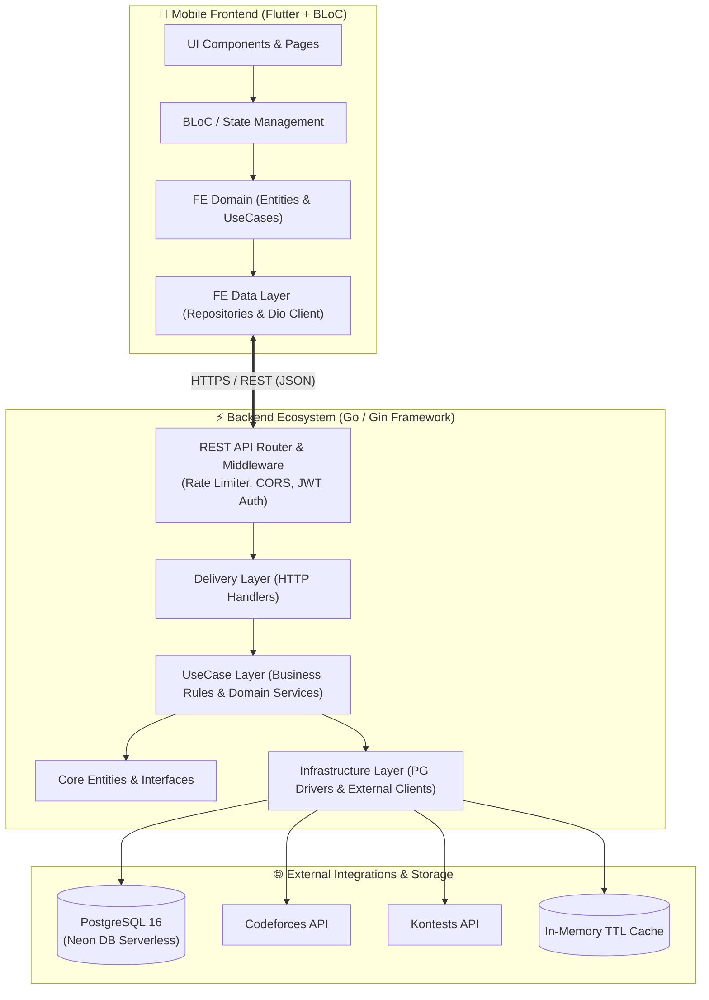

# 🧭 CPD Hub — Competitive Programming Management Ecosystem

> **CPD Hub** is an enterprise-grade, full-stack Competitive Programming management platform engineered for the **Computer Science & Engineering Club (CSEC) Competitive Programming Division (CPD)**. It empowers **30+ core division members** and **100+ active community developers** to streamline daily problem-solving consistency, track rating progressions, monitor live contest leaderboards, and master structured algorithmic learning tracks.

---

## 🌟 Core Capabilities & Features

### 1. 📊 Consistency & Activity Analytics
- **GitHub-Style Contribution Heatmaps**: Visualizes daily problem-solving submissions over a 365-day rolling window.
- **Streak & Goal Engine**: Custom daily target setting (e.g., 2 problems/day) with automatic streak protection and maintenance logic.
- **Rating Progression Graphs**: Interactive historical rating performance charts for competitive programming platforms.
- **Attendance & Event Tracker**: Member check-ins and session attendance recording for division workshops.

### 2. 🏆 Contest Hub & Live Standings
- **Multi-Platform Contest Aggregation**: Syncs upcoming & historical contests from Codeforces, LeetCode, AtCoder, CodeChef, and Kontests API.
- **Real-Time Leaderboard Synchronizer**: High-performance TTL-cached standings fetched live from Codeforces API with rank, penalty, and problem-by-problem status.
- **Participation Manager**: One-tap contest registration, reminders, and post-contest performance reviews.

### 3. 📚 Structured Learning & Course Tracks
- **Curated Algorithmic Topics**: Complete coverage across Data Structures, Dynamic Programming, Graph Theory, String Algorithms, and Mathematics.
- **Prerequisite Graphs**: Directed acyclic graph (DAG) mapping topic dependencies so learners progress logically.
- **Video & Reading Modules**: Embedded video tutorials, CP-Algorithms guides, USACO Guide references, and interactive quizzes.

### 4. 🧠 Smart Practice & Spaced Repetition Queue
- **Spaced Repetition Review Queue**: Algorithm-driven problem review intervals to maximize long-term retention of key concepts.
- **Upsolving Manager**: Automatic queueing of unsolved contest problems for post-contest practice.
- **Problem Bookmark & Tagging**: Organize problems by personal difficulty, rating tags, or custom collections.

### 5. 📰 Articles Feed & Division Announcements
- **Editorial & Tutorial Feed**: Curated articles covering contest solutions, algorithm deep-dives, and division announcements.
- **Codeforces Blog Integration**: Live ingestion of top competitive programming blogs and editorial breakdowns.

---

## 🏗️ System Architecture & Design Patterns

The project is architected following **Clean Architecture (Hexagonal Architecture)** principles on both the frontend and backend to guarantee strict separation of concerns, high testability, and decoupled transport/persistence mechanisms.

### Clean Architecture Layers
1. **Domain Layer**: Contains pure business entities, value objects, domain logic, and abstract repository contracts. Has zero external dependencies.
2. **UseCase / Application Layer**: Encapsulates feature-specific business workflows (e.g., user signup, contest ranking recalculation, spaced repetition scheduling).
3. **Data / Infrastructure Layer**: Implements repository contracts, handles SQL database persistence via `pgxpool`, external HTTP client integrations, and secure local token storage.
4. **Presentation / Delivery Layer**: Manages state transitions using BLoC on the client and Gin HTTP route handlers / middleware on the server.
